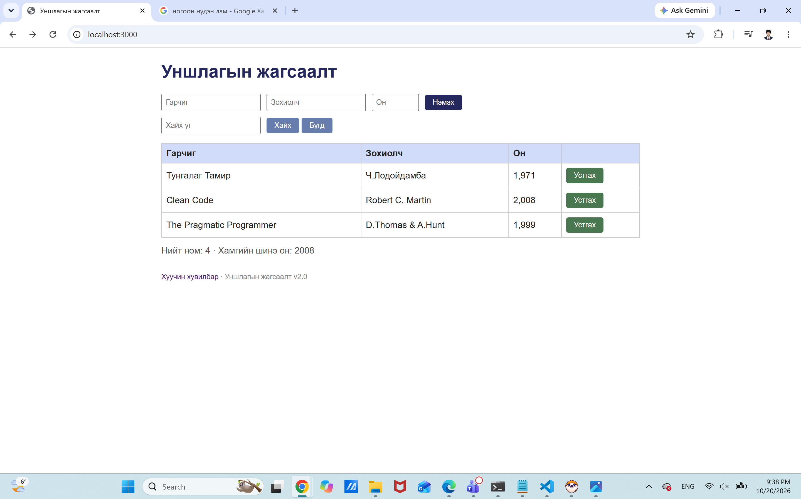

# BUG-03: Нийт номын тоолуур анх апп асаахад бодит өгөгдлөөс зөрүүтэй буруу утга харуулж байна

Орчин: Уншлагын жагсаалт v2.0, Chrome , Windows 11, 2026-10-20
Урьдчилсан нөхцөл: node app.js-ийг шинээр асаасан (анхны 3 ном)

## Дахин гаргах алхам
1. Браузераар `http://localhost:3000` хаягийг нээж, хүснэгтэд буй номыг тоолно (3 ном).
2. Хүснэгтийн доорх «Нийт ном: ...» мөрийг харна.
3. Терминалд `curl.exe -i http://localhost:3000/api/stats` ажиллуулж, `total` талбарыг харна.

Хүлээгдэж байсан: Спецификацийн дүрэм — «"Нийт ном" тоолуур хүснэгтэд буй номын тоотой тэнцүү.» Өөрөөр хэлбэл `3`.
Бодит үр дүн: Хуудсан дээр «Нийт ном: 4», `/api/stats` нь `{"total":4,"newest":2008}` буцаана, харин хүснэгтэд 3 ном байна.

Ноцтой байдал: Minor — Хэрэглэгчид харагдах статистик мэдээлэл бодит байдалтай тохирохгүй байна.
## Хавсралт

API нотолгоо: [evidence/bug-03-curl.txt](../evidence/bug-03-curl.txt)
Олдсон аялал: Saboteur