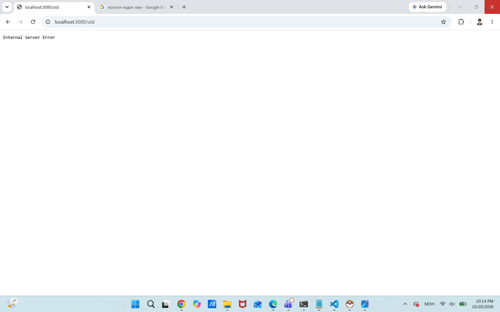

# BUG-09: "Хуучин хувилбар" холбоос дээр дархад Internal Server Error гарч ажиллахгүй байна

Орчин: Уншлагын жагсаалт v2.0, Chrome, Windows 11 2026-10-20
Урьдчилсан нөхцөл: node app.js-ийг шинээр асаасан (анхны 3 ном)

## Дахин гаргах алхам
1. Браузераар `http://localhost:3000` хаягийг нээж орно.
2. Хуудас дээрх "Хуучин хувилбар" (Prior Version) линк эсвэл товч дээр дарна.
3. Гарч буй үр дүнг ажиглана.

Хүлээгдэж байсан: Бүх хуудас болон холбоосууд ямар нэгэн алдаагүй хэвийн ажиллах ёстой.
Бодит үр дүн: "Internal Server Error" гэсэн серверийн алдаа гарч вэб хуудас гацаж байна.

Ноцтой байдал: Critical — Аппын үндсэн хэсэг эсвэл холбоос бүрэн ажиллахгүй, сервер талаас алдаа буцааж байна.
## Хавсралт

API нотолгоо: [evidence/bug-09-curl.txt](../evidence/bug-09-curl.txt)
Олдсон аялал: Saboteur